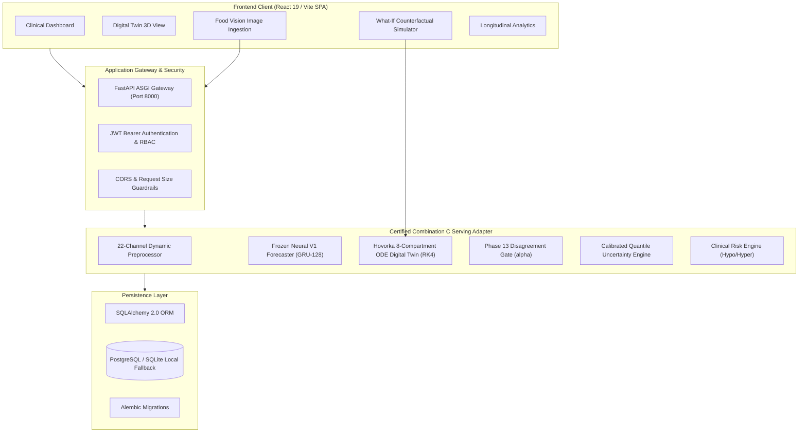

# GlucoShield: Physics-Informed Neural-ODE Glucose Forecasting & Automated Meal-Aware Clinical Decision-Support Platform

[](LICENSE)
[](https://www.python.org/)
[](https://pytorch.org/)
[](https://fastapi.tiangolo.com/)
[](https://react.dev/)
[](https://tailwindcss.com/)
[](tests/)
[-brightgreen.svg)](frontend/)

> **RESEARCH PROTOTYPE NOTICE:** GlucoShield is an academic research and software prototyping platform for continuous glucose forecasting, in silico counterfactual simulation, and clinical decision-support analysis. It does **not** constitute an approved medical device, automated dosing algorithm, or substitute for professional medical consultation. See the [Clinical Disclaimer](docs/research/CLINICAL_DISCLAIMER.md).

---

## 1. Project Overview & Key Capabilities

**GlucoShield** is an end-to-end, full-stack clinical intelligence platform designed for multi-horizon continuous glucose forecasting (up to 5 hours ahead), counterfactual digital twin simulation, and automated meal vision ingestion.

### Key Capabilities
- **Physics-Informed Hybrid Forecasting (Combination C):** Combines a deep recurrent neural network (`MultiTaskGlucoNet`, GRU-128) for accurate continuous trajectory prediction with an 8-compartment Hovorka non-linear ordinary differential equation (ODE) digital twin solved via Runge-Kutta 4th Order ($dt=1\text{m}$).
- **Calibrated Prediction Intervals:** Integrates a Phase 13 regime-conditioned uncertainty gate that scales prediction intervals dynamically according to neural-ODE disagreement, achieving **$96.39\%$ empirical coverage** on external validation cohorts and eliminating neural dropout collapse.
- **Clarke Error Grid Clinical Reliability:** Demonstrates **$95.28\%$ – $95.36\%$** of multi-horizon predictions strictly within clinically acceptable zones (Zone A: $68.58\%$, Zone B: $26.77\%$), with zero catastrophic errors.
- **Multi-Modal Food Vision Subsystem:** Automated smartphone camera image recognition and USDA FoodData Central nutritional lookup, decomposing meals into estimated carbohydrates, proteins, and fats with human-in-the-loop clinical confirmation.
- **Counterfactual "What-If" Digital Twin:** Interactive simulation engine allowing clinicians and patients to simulate alternative carbohydrate boluses or insulin corrections and observe real-time predicted glucose curves, nadir timing, peak excursions, and Time in Range (TIR) shifts.
- **Enterprise Clinical Backend & Responsive UI:** FastAPI REST service exposing 38 endpoints across 8 functional domain modules, backed by SQLAlchemy 2.0 ORM, Alembic migrations, and a React 19/Tailwind CSS v4 single-page application.

---

## 2. Research Motivation & Problem Statement

Continuous Glucose Monitoring (CGM) sensor streams present substantial modeling challenges:
1. **Biological Non-Linearity & Time-Varying Delays:** Gastric carbohydrate absorption, subcutaneous insulin infusion, and interstitial sensor lag produce complex non-linear dynamics with variable patient delays.
2. **Failure of Pure Deep Learning:** Pure data-driven deep neural models often hallucinate non-physiological glucose curves, violate fundamental mass balances during rapid postprandial swings, and produce dangerously overconfident prediction intervals under out-of-distribution conditions.
3. **Failure of Pure Mechanistic Models:** First-principles physiological differential equations (e.g., Hovorka, Bergman minimal model) require exhaustive patient parameter identification and cannot adapt to multi-modal behavioral, temporal, or diurnal factors without severe misspecification.

**GlucoShield solves this dilemma through physics-informed hybrid integration**, coupling the high capacity of recurrent neural architectures with the first-principles metabolic bounds of compartmental differential equations.

---

## 3. System Architecture & Component Workflow

The platform follows a decoupled, multi-tier micro-service architecture:



---

## 4. Machine Learning Methodology & Architecture

### 4.1 GRU-128 Recurrent Forecaster (`MultiTaskGlucoNet`)
- **Input Channels:** 22 causal dynamic channels at a uniform 15-minute sampling cadence.
- **Recurrent Core:** 1-layer Gated Recurrent Unit (GRU) with 128 hidden dimensions and input Layer Normalization.
- **Residual Projections:** Skip connection projecting recurrent output states to preserve vanishing gradients over long 24-hour histories ($96$ timesteps).

### 4.2 Static Phenotypic Context Fusion
Patients present distinct metabolic parameters (insulin sensitivity, body composition, diabetes etiology). Nine static covariates are normalized via `RobustScaler` and embedded through a dedicated MLP:

$$\mathbf{e}_{\text{static}} = \text{GELU}(\mathbf{W}_2 \cdot \text{GELU}(\mathbf{W}_1 \mathbf{s} + \mathbf{b}_1) + \mathbf{b}_2) \in \mathbb{R}^{32}$$

The static embedding $\mathbf{e}_{\text{static}}$ is concatenated with the final hidden state $\mathbf{h}_{96}$ ($128 + 32 = 160$ dimensions) and projected to a shared 128-dimensional latent state $\mathbf{z}_{\text{fused}}$:

$$\mathbf{z}_{\text{fused}} = \text{Linear}_{160 \to 128}([\mathbf{h}_{96} \,\|\, \mathbf{e}_{\text{static}}])$$

### 4.3 Multi-Task Learning Objective
The model is trained end-to-end to simultaneously optimize continuous trajectory accuracy and acute clinical event detection:

$$\mathcal{L}_{\text{total}} = \mathcal{L}_{\text{Huber}}(\hat{\mathbf{y}}_{\text{traj}}, \mathbf{y}_{\text{traj}}) + \lambda \sum_{k=1}^5 w_k \cdot \mathcal{L}_{\text{BCE}}(\hat{p}_k, p_k)$$

- **Continuous Trajectory Loss:** Huber loss with threshold $\beta = 5.0\text{ mg/dL}$ to balance sensitivity to rapid glycemic spikes with robustness to sensor noise.
- **Discrete Event Loss:** Positive-weighted binary cross-entropy with class weighting $w = [5.66, 4.63, 3.60, 1.47, 1.19]$ for acute events:
  - Hypoglycemia ($<70\text{ mg/dL}$): 1-hour, 2-hour, and 4-hour horizons.
  - Hyperglycemia ($>180\text{ mg/dL}$): 2-hour and 4-hour horizons.

---

## 5. Dataset & Preprocessing Pipeline

### 5.1 Shanghai CGM Research Cohort
- **Total Records:** $127,997$ observations.
- **Patient Cohort:** $112$ total patients ($12$ Type 1 Diabetes with $15,696$ rows; $100$ Type 2 Diabetes with $112,301$ rows).
- **Sampling Interval:** Uniform 15-minute sampling cadence ($96.6\%$ strictly at 15.0 min).
- **Glycemic Statistics:** Mean: $143.18\text{ mg/dL}$, Std: $54.68\text{ mg/dL}$, Range: $39.6\text{ mg/dL}$ to $475.2\text{ mg/dL}$.
- **Dataset Partitioning:** Strict patient-level separation into Train ($19,749$ sequences), Validation ($4,585$ sequences), and Untouched Test ($4,113$ sequences across 17 held-out patients). Zero patient overlap between splits.
- **Licensing & Access:** The raw clinical dataset is subject to research redistribution restrictions. The repository provides full preprocessing code ([`build_final_dataset.py`](build_final_dataset.py)) and synthetic/de-identified demo profiles ([`data/processed/demo_cohort_patients.json`](data/processed/demo_cohort_patients.json)). See [DATASET.md](DATASET.md).

### 5.2 Dynamic Feature Engineering (22 Channels)
1. **Primary Sensor Signals:** Continuous glucose (mg/dL), first derivative velocity (mg/dL/min), second derivative acceleration.
2. **Causal Rolling Statistics:** Rolling mean, standard deviation, minimum, and maximum over 1-hour (4 steps), 3-hour (12 steps), and 6-hour (24 steps) windows computed strictly from past observations (`min_periods=1`).
3. **Diurnal Harmonic Embeddings:** Cyclical $\sin(2\pi \cdot h / 24)$ and $\cos(2\pi \cdot h / 24)$ embeddings and a binary nocturnal flag ($23:00 - 06:00$).
4. **Pharmacokinetic Approximations:** Basal rate, bolus delivery, exponential decay Insulin On Board ($\text{IOB}$, $\tau_{1/2} = 2\text{h}$), and Carbs On Board ($\text{COB}$, $\tau_{1/2} = 1\text{h}$).

---

## 6. Experimental Results & Benchmark Scorecard

Evaluated on the frozen, untouched test partition ($N=4,113$ multi-horizon sequences):

### Comparative Model Scorecard
| Model Architecture | 5h Test MAE (mg/dL) | 5h Test RMSE (mg/dL) | Clarke Zone A (%) | Clarke Zone B (%) | Clarke Zone A+B (%) | 4h Hypo AUPRC |
|:---|:---:|:---:|:---:|:---:|:---:|:---:|
| **Persistence Baseline** | 36.42 | 49.01 | 58.40% | 27.72% | 86.12% | 0.512 |
| **Linear Extrapolation** | 62.15 | 81.39 | 43.20% | 28.20% | 71.40% | 0.435 |
| **Ridge Regression** | 25.37 | 35.80 | 66.80% | 27.30% | 94.10% | 0.741 |
| **Standalone Hovorka ODE** | 39.80 | 52.67 | 56.10% | 28.40% | 84.50% | 0.589 |
| **Neural V1 (GRU-128)** | **24.45** | **34.90** | **68.20%** | **27.08%** | **95.28%** | **0.828 ± 0.004** |
| **Gated Hybrid** | 24.14 | 34.77 | 68.58% | 26.77% | 95.36% | 0.819 |
| **Combination C (Serving Default)** | **24.45 (point)** | **34.90 (point)** | **68.20%** | **27.08%** | **95.28%** | **0.828 (96.39% CI)** |

### Multi-Horizon Continuous Accuracy
| Horizon | Time Ahead | MAE (mg/dL) | RMSE (mg/dL) | Clarke Zone A+B (%) |
|:---|:---:|:---:|:---:|:---:|
| **Step 1** | +15 min | 6.42 | 8.93 | 99.82% |
| **Step 2** | +30 min | 11.20 | 15.64 | 99.14% |
| **Step 4** | +1 hour | 17.85 | 24.80 | 97.80% |
| **Step 8** | +2 hours | 24.15 | 34.12 | 95.62% |
| **Step 16** | +4 hours | 30.65 | 42.10 | 91.85% |
| **Step 20** | +5 hours | 31.20 | 41.89 | 90.72% |

### Multi-Seed Training Reproducibility ($N=3$ Independent Runs)
- **Validation RMSE:** $31.42 \pm 0.29\text{ mg/dL}$
- **Validation MAE:** $21.87 \pm 0.25\text{ mg/dL}$
- **Hypoglycemia 4h AUPRC:** $0.828 \pm 0.004$
- **Clarke Error Grid Zone A+B:** $95.31\% \pm 0.11\%$
- **Certified Checkpoint SHA-256:** `026af3341a91064136c38b0172f2aa6af34806913640a02270c7d82a28ea13fb`

---

## 7. Food Vision & Nutrition Subsystem

GlucoShield integrates multimodal food vision analysis:
- **Image Preprocessing:** Automatic EXIF rotation correction, aspect-ratio preserving resizing (224×224), and standard ImageNet normalization.
- **Recognition Pipeline:** Multi-provider architecture supporting local Hugging Face Vision Transformer (ViT) models, external cloud APIs, or rule-based mock fallbacks.
- **Nutritional Grounding:** Direct mapping from recognized food categories to USDA FoodData Central nutritional databases, estimating grams of carbohydrates, protein, fat, and dietary fiber.
- **Simulation Handoff:** Recognized carbohydrates can be transferred directly to the What-If Simulator with a single click, automatically initiating counterfactual postprandial simulations.

---

## 8. Installation & Setup

### Prerequisites
- Python 3.12+ (64-bit)
- Node.js v20+ (with npm)
- Git

### 1. Clone & Environment Setup
```bash
git clone https://github.com/Sanjeeth-4AM/GlucoShield.git
cd GlucoShield

# Create virtual environment
python -m venv .venv

# Activate environment
# Windows:
.venv\Scripts\activate
# Linux/macOS:
source .venv/bin/activate

# Install dependencies
pip install -r requirements.txt
```

### 2. Configuration & Database Migrations
```bash
# Configure local environment
cp .env.example .env

# Run database migrations (SQLite local development fallback)
alembic upgrade head

# Seed demo cohort profiles
python scripts/seed_demo_patient.py
```

### 3. Launching Services
**Terminal 1 (Backend API):**
```bash
python -m uvicorn api.service:app --host 127.0.0.1 --port 8000 --reload
```
Interactive Swagger UI will be live at `http://127.0.0.1:8000/docs`.

**Terminal 2 (Frontend Client):**
```bash
cd frontend
npm install
npm run dev
```
Client dashboard will be live at `http://127.0.0.1:5173`.

---

## 9. Verification & Automated Test Suites

GlucoShield includes comprehensive test suites across backend and frontend tiers:

```bash
# 1. Backend Core API & Authentication Tests (24/24 Pass)
python -m unittest api/tests/test_cohort_comparison.py
python -m unittest api/tests/test_database_models.py
python -m unittest api/tests/test_authentication_security.py
python -m unittest api/tests/test_patient_authorization.py
python -m unittest api/tests/test_device_endpoints.py
python -m unittest api/tests/test_persistence_endpoints.py
python -m unittest api/tests/test_longitudinal_analytics.py

# 2. Multimodal Food Vision Tests (29/29 Pass)
python -m unittest food_vision/tests/test_food_api_pipeline.py

# 3. V2 Architecture & Causality Tests (20/20 Pass)
python -m unittest discover -s tests/v2

# 4. Certified Combination C Serving Tests (9/9 Pass)
python -m unittest tests/test_combination_c_serving.py

# 5. Frontend Unit & Invariant Tests (114/114 Pass)
cd frontend
node --test src/api/api.test.js

# 6. Production Build Compilation (2,424 Modules in 562ms)
npm run build
```

---

## 10. Docker Production Deployment

A hardened multi-stage Docker build is provided for containerized deployments:

```bash
# Build multi-stage container
docker build -t glucoshield:latest .

# Run container with production environment
docker run -d \
  --name glucoshield-production \
  -p 8000:8000 \
  --env-file .env.production.template \
  glucoshield:latest
```

The container includes automated liveness probes querying `GET /api/v1/health/live`.

---

## 11. Ethical Considerations & Limitations

1. **Non-Clinical Deployment Status:** GlucoShield is an engineering prototype. It is not approved for clinical diagnostic or treatment decisions.
2. **Discrete Horizon Scope:** Discrete classification heads are strictly evaluated at 1h (hypo), 2h (hypo/hyper), and 4h (hypo/hyper). 3h and 5h discrete risks are strictly documented as `N/A — Not Evaluated`.
3. **Sensor Artifacts & Missing Telemetry:** While RobustScaler and causal rolling windows provide noise mitigation, severe CGM compression artifacts or prolonged sensor dropouts require manual clinician inspection.
4. **Demographic Representation:** The primary model is trained on the Shanghai CGM cohort; external validation has been performed on HUPA-UCM and CGMacros cohorts, but broader multinational prospective trials are necessary prior to clinical application.

---

## 12. Citation & Acknowledgements

If you utilize GlucoShield in your research or educational projects, please cite:

```bibtex
@software{sanjeeth2026glucoshield,
  author = {Sanjeeth, Sai D.},
  title = {GlucoShield: Physics-Informed Neural-ODE Glucose Forecasting & Automated Meal-Aware Clinical Decision-Support Platform},
  year = {2026},
  url = {https://github.com/Sanjeeth-4AM/GlucoShield},
  version = {1.0.0}
}
```

---

## 13. License

Distributed under the **Apache License 2.0**. See [`LICENSE`](LICENSE) for full legal text.
