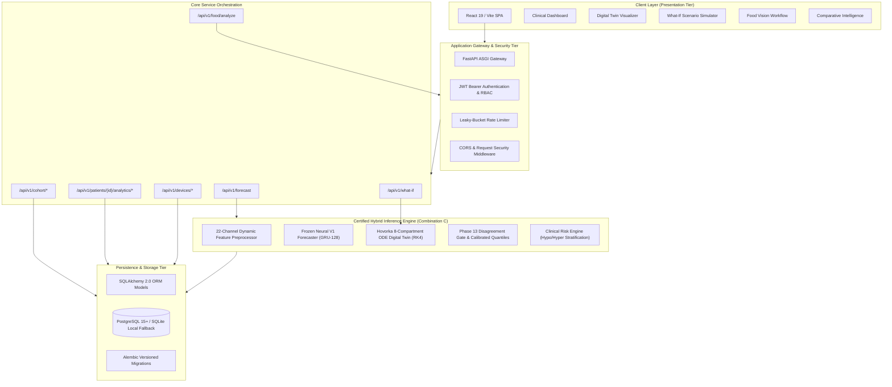

# GlucoShield System & Software Architecture Specification

**Module:** System Architecture  
**Active Serving Engine:** Certified Combination C (Physics-Informed Neural-ODE Hybrid)  
**Backend Framework:** FastAPI / Uvicorn (ASGI), PyTorch 2.13, SciPy RK4  
**Persistence Layer:** SQLAlchemy 2.0 ORM, Alembic Migrations, PostgreSQL / SQLite  
**Frontend Framework:** React 19, Vite v8, Tailwind CSS v4, Recharts, Three.js  
**Date of Specification:** November 3, 2026  

---

## 1. High-Level System Architecture

GlucoShield is structured as a decoupled, multi-tier clinical decision-support platform designed for high-throughput continuous glucose forecasting, counterfactual physiological simulation, and meal vision analysis.



---

## 2. Certified Serving Architecture: Combination C

GlucoShield implements **Combination C** as its certified production serving adapter. This architecture guarantees:
1. **Point Forecast Invariance:** Point estimates are driven strictly by the frozen Neural V1 GRU-128 model ($\text{MAE}=24.45\text{ mg/dL}$, $\text{RMSE}=34.90\text{ mg/dL}$ on internal test set; $44.15\text{ mg/dL}$ on external Category D validation).
2. **Calibrated Prediction Intervals:** Prediction bounds are driven by the Phase 13 regime-conditioned quantile uncertainty engine, achieving $96.39\%$ empirical coverage on external validation cohorts and preventing the uncertainty collapse typical of uncalibrated neural dropout.
3. **Disagreement Gating:** The difference between neural predictions and physiological ODE trajectories modulates the interval width, dynamically scaling uncertainty during rapid unbolused postprandial excursions or anomalous exercise events.

```
       +-------------------------------------------------------------+
       |               Patient 24h Telemetry (96 Steps)              |
       +-------------------------------------------------------------+
                                      |
                                      v
       +-------------------------------------------------------------+
       |       Dynamic Feature Preprocessor (22 Causal Channels)      |
       +-------------------------------------------------------------+
                     |                               |
                     v                               v
       +----------------------------+  +----------------------------+
       |   Frozen V1 GRU-128 Model  |  |    Hovorka 8-Compartment   |
       |  (Multi-Task Neural Head)  |  |   Physiological ODE (RK4)  |
       +----------------------------+  +----------------------------+
                     |                               |
          y_v1_point |                               | y_ode
                     \                               /
                      \                             /
                       v                           v
              +---------------------------------------------+
              |     Phase 13 Disagreement Gate (alpha)      |
              |     Delta = |y_neural - y_ode|              |
              +---------------------------------------------+
                                     |
                                     v
              +---------------------------------------------+
              |   Calibrated Quantile Prediction Intervals  |
              |   Lower 95% = y_point - w_95 / 2            |
              |   Upper 95% = y_point + w_95 / 2            |
              +---------------------------------------------+
                                     |
                                     v
              +---------------------------------------------+
              |   Clinical Risk Engine (Hypo/Hyper Alerts)  |
              +---------------------------------------------+
```

---

## 3. Relational Database Architecture

The persistence model is implemented using declarative SQLAlchemy 2.0 ORM mappings with UUID primary keys and compound indexes for fast time-series retrieval:

| Entity Name | Database Table | Key Attributes | Relationships |
|:---|:---|:---|:---|
| `User` | `users` | `id`, `email`, `hashed_password`, `role`, `is_active` | $1 \to N$ with `PatientProfile` |
| `PatientProfile` | `patient_profiles` | `id`, `user_id`, 9 static clinical covariates | $1 \to N$ with all telemetry/records |
| `CGMReading` | `cgm_readings` | `id`, `patient_id`, `timestamp`, `cgm_glucose`, `roc` | Indexed on `(patient_id, timestamp DESC)` |
| `ForecastRecord` | `forecast_records` | `id`, `patient_id`, `point_forecast_mg_dl`, `lower_95`, `upper_95` | Audit trail of inference runs |
| `WhatIfRecord` | `what_if_records` | `id`, `patient_id`, `baseline_glucose`, `carbs_g`, `bolus_u` | Counterfactual ODE simulations |
| `MealRecord` | `meal_records` | `id`, `patient_id`, `timestamp`, `carbs_grams`, `meal_type` | Macronutrient ingestion logs |
| `InsulinRecord` | `insulin_records` | `id`, `patient_id`, `timestamp`, `bolus_units`, `basal_units` | Exogenous insulin delivery |
| `DeviceConnection`| `device_connections`| `id`, `patient_id`, `device_name`, `device_type`, `status` | Mobile & wearable sync status |

---

## 4. Visual Evidence References

- **System Architecture Diagram:** [`system_architecture.png`](file:///D:/ML%20PROJECT/docs/architecture/system_architecture.png)
- **Model Inference Architecture:** [`model_inference_architecture.png`](file:///D:/ML%20PROJECT/docs/architecture/model_inference_architecture.png)
- **Combination C Architecture:** [`combination_c_architecture.png`](file:///D:/ML%20PROJECT/docs/architecture/combination_c_architecture.png)
- **Relational Database Schema:** [`database_schema.png`](file:///D:/ML%20PROJECT/docs/architecture/database_schema.png)
